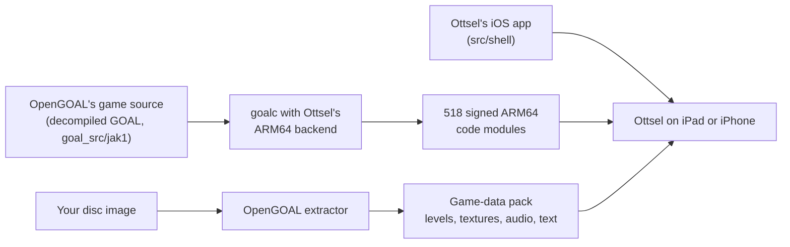

# Ottsel

  <strong>Jak and Daxter: The Precursor Legacy, running natively on iPad and iPhone.</strong> 
  Naughty Dog's own game code, recovered by OpenGOAL and compiled ahead of time to signed ARM64. OpenGOAL's renderer on Metal, touch controls, controllers, TV output, cheats and texture packs.

  
  
  
  
  
  
  
  
  

> [!IMPORTANT]
> **Bring your own game data.** Ottsel needs your own Jak and Daxter: The Precursor Legacy disc image
> (NTSC-U `SCUS-97124`). This repository contains no disc image, extracted game files or saves.
>
> **Developer preview.** Ottsel runs on a physical iPad Pro 12.9-inch (M2) at the iPad's full resolution
> and 60 fps, by touch or with a controller. It has not run on a physical iPhone yet, and there is no
> downloadable IPA: you build it on a Mac and install it on your own device.
>
> **AI disclosure:** Ottsel uses substantial AI assistance for code, tests, documentation, debugging and
> maintenance. There is no audited percentage of AI-generated code. Status and test records describe
> what was checked. This disclosure concerns Ottsel's workflow, not the authorship of OpenGOAL.

## How Ottsel works

Naughty Dog wrote Jak and Daxter in GOAL, their own Lisp-based language, and shipped it as compiled
PlayStation 2 code. [OpenGOAL](https://github.com/open-goal/jak-project) turned that compiled code back
into readable GOAL source with a decompiler, cleaned it up by hand, and wrote a new GOAL compiler, a C++
runtime and an OpenGL renderer so it runs natively on PC. The gameplay you play is the original game's
code, neither emulated nor remade; the parts that once talked to PS2 hardware (graphics, sound, input,
memory card) are OpenGOAL's replacements.

Ottsel takes that to iPad and iPhone. OpenGOAL normally compiles and loads the game's code while it
runs, and iOS does not allow an app to create executable code. Ottsel therefore compiles all of it to
ARM64 on your Mac, ahead of time, and signs every module into the app like ordinary app code; loading
code at run time is fatal by design. OpenGOAL's renderer runs on Metal through ANGLE, and Ottsel wraps
the game in an iOS app: touch controls, controller and keyboard input, TV output, the ••• menu, saves and
logging.

Your disc supplies everything that is art and data rather than code: levels, textures, models, music,
sound and text. OpenGOAL's extractor pulls these out of your disc image on your Mac, and they travel to
your device in a game-data pack that never enters this repository.

| Piece | Where it comes from |
| --- | --- |
| The game's code (534 GOAL source files) | OpenGOAL's repository at a pinned commit, cloned by the build into `out/` |
| Ottsel's changes to OpenGOAL | [`patches/ottsel-jak-project.patch`](patches/ottsel-jak-project.patch): the ARM64 compiler backend, the signed-module loader, the iOS runtime, renderer, sound and input work, and small changes to 29 of the game's GOAL files |
| The iOS app | [`src/shell/`](src/shell/): boot, touch controls, the ••• menu, TV output, logging and the icon |
| Levels, textures, audio and text | Your disc, through OpenGOAL's extractor, into your data pack |
| OpenGL ES on Metal | [ANGLE](https://chromium.googlesource.com/angle/angle), downloaded prebuilt by the build |

This repository holds Ottsel's own code, its build scripts and its one patch against OpenGOAL.
Everything else is cloned, downloaded or extracted from your disc when you build.

## Get Ottsel

| Platform | Status | Setup |
| --- | --- | --- |
| iPad | Build from source; runs on an iPad Pro 12.9-inch (M2) | [Build from source](#build-from-source), then `scripts/install-ios-device.sh` |
| iPhone | Build from source; Simulator-tested | Same build (the app is universal) |
| Downloadable IPA | Not available yet | Waits until every game-derived file lives in your data pack |

**Need help or found a bug?** Join the [Discord](https://discord.gg/xwHfUD2bxW), use
**••• → Help & Feedback → Report a Problem** in the app, or open a
[device report](https://github.com/chrissotraidis/ottsel/issues/new?template=device_report.yml) or
[bug report](https://github.com/chrissotraidis/ottsel/issues/new?template=bug_report.yml). A report from
an iPad or iPhone not listed here is the most useful thing you can send right now.

## Playing

[Frequently asked questions](#frequently-asked-questions) · [Mods, texture packs and cheats](docs/MODS.md) · [Current status](docs/STATUS.md)

- **Touch controls.** The move stick appears wherever your left thumb lands and follows it; L1/L2,
  R1/R2, the D-pad, the face buttons, START and the camera stick sit at the screen edges and respond to a
  sliding thumb. **••• → Touch Controls** sets when they show, their opacity and size, and lets you drag
  and resize each one.
- **Controllers and keyboards.** Xbox, PlayStation and other Apple-supported controllers work like a
  PlayStation pad; hardware keyboards use OpenGOAL's layout (W/A/S/D, I/J/K/L camera, Space/E/F/R, Return
  for Start). The touch controls hide as soon as you use either and come back on your next touch or when
  the controller disconnects.
- **Play on a TV.** Connect a TV or monitor over HDMI or USB-C, or use AirPlay: the game fills it at the
  display's resolution and the iPad becomes the controller. Unplug and the game returns to the iPad.
- **Cheats.** **••• → Cheats** switches OpenGOAL's cheats on in one tap: invincibility, infinite eco,
  big and huge heads, big fist, blue Daxter, mirror world and more. The original button codes work too.
- **Saves and interruptions.** Save from the pause menu as on the PS2; Load Game resumes after a
  relaunch. Leaving the app pauses the game and its sound, and you come back to the pause menu.
- **Help and logs.** **••• → Help & Feedback** opens a GitHub device report with your device, OS version
  and frame rate filled in, shares the app's logs, and links the Discord and this repository.
- **Texture packs.** `scripts/apply-texture-pack.sh` builds a data pack with any OpenGOAL-format texture
  pack. See the [mods guide](docs/MODS.md).

The ••• menu holds Display (render resolution, FPS counter), Cheats, Touch Controls, Game Data, Help &
Feedback, and Diagnostics (log overlay, jump to a level for testing).

<table>
  <tr>
    <td width="50%"></td>
    <td width="50%"></td>
  </tr>
  <tr>
    <td align="center"><strong>The ••• menu</strong> Settings, cheats, game data and help.</td>
    <td align="center"><strong>Touch Control Settings</strong> Visibility, floating stick, opacity, size and camera.</td>
  </tr>
  <tr>
    <td width="50%"></td>
    <td width="50%"></td>
  </tr>
  <tr>
    <td align="center"><strong>On a TV</strong> The game at the display's resolution.</td>
    <td align="center"><strong>The iPad as controller</strong> Touch controls and menu stay on the iPad.</td>
  </tr>
</table>

## What has been tested

**On a physical iPad** (iPad Pro 12.9-inch, 6th generation, M2, iPadOS 27.0.1;
[evidence](docs/evidence/G2/g2-first-ipad-hardware-run-2026-10-10.md)):

| Area | Result |
| --- | --- |
| Boot and play | Data pack imported on first launch; the intro, Geyser Rock and Sandover play with every code module signed and no faults |
| Frame rate | 2732×2048, 60 fps for 98.5% of a 29-minute session |
| Sound | Music, effects, voice hints and cutscene dialogue all play; voice hints no longer silence the rest of the game |
| Input | Touch and an Xbox Series X controller both play; the touch controls hide and return with the controller, and can be moved and resized |
| Saves | OpenGOAL PC saves copied onto the iPad fill slots 2–4 (the Citadel, Rock Village and Volcanic Crater, all with 100 power cells); Rock Village loads and plays at 60 fps |
| Updates | Reinstalling over the app keeps saves and settings |

**In the Simulators** (iPad Pro 11-inch M4 and iPhone 16 Pro, native resolution):

| Area | Result |
| --- | --- |
| Levels | All 16 hubs and levels load and run at 51–60 fps (2420×1668; 12 of 16 hold 60) with no faults |
| Saves | Saving in Sandover, quitting, relaunching and loading resumes in Sandover |
| Sound | Music, effects and dialogue mix and play; a recorded minute showed no clipping or dropouts |
| TV output | 1080p external display from a cold launch, unplugged and replugged mid-game |
| Touch | A scripted real-touch run plays title → Load Game → the saved level, walks, jump-attacks, and opens the ••• menu and the layout editor |
| iPhone | Boots to the title with the full touch layout fitted to the screen |

Not yet tested: a physical iPhone, a real HDMI adapter or AirPlay, long sessions (heat and battery),
and a full play-through on a device.

## Build from source

You need an Apple Silicon Mac with Xcode, `brew install cmake ninja ripgrep glslang spirv-cross xcodegen`,
an Apple ID signed in to Xcode for a physical device (a free Personal Team is enough), and your disc image.
Everything the build generates stays under the ignored `out/` directory; keep your disc image outside
the repository or in the ignored `ref/` folder.

~~~sh
# 1. OpenGOAL at the pinned commit, plus Ottsel's patch
git clone https://github.com/chrissotraidis/ottsel && cd ottsel
git clone https://github.com/open-goal/jak-project out/jak-project
git -C out/jak-project checkout 641fb572e876750d8618434d9f7c1a531b43b366
git -C out/jak-project apply --binary ../../patches/ottsel-jak-project.patch

# 2. Host tools, your disc's art and data, and the game's code compiled for arm64
cd out/jak-project
cmake -S . -B build/h1 -G Ninja -DCMAKE_BUILD_TYPE=Release -DCMAKE_C_COMPILER=clang \
  -DCMAKE_CXX_COMPILER=clang++ -DSTATICALLY_LINK=OFF -DINSTALL_GTEST=OFF -DOTTSEL_NO_EMIT=ON
ninja -C build/h1 goalc extractor ottsel-a11-slice
./build/h1/decompiler/extractor --extract --decompile /path/to/jak1.iso
./build/h1/goalc/goalc --game jak1 --isa arm64 -c '(mi)'
cd ../..

# 3. A game-data pack from your disc, outside the repository
scripts/prepare-user-data-pack.sh out/jak-project/iso_data/jak1 /tmp/ottsel-pack out/jak-project/out/jak1/fr3
~~~

Step 2's extractor reads your disc's levels, textures and text (it does not decompile code; that source
is already in OpenGOAL), and `goalc` compiles the game's GOAL source to ARM64. A first build takes
about 10 to 15 minutes on an M-series Mac; later builds take a few minutes.

**iPad or iPhone:** connect the device by cable, trust the Mac, turn on Developer Mode, then run
`scripts/install-ios-device.sh /tmp/ottsel-pack`. It finds your signing identity and a development
profile (creating one through Xcode if needed), builds and signs the app, installs it, copies your pack
in and launches it. Later you can import a pack from Files with **••• → Game Data → Import Game Data…**.

**Simulator:** build with
`OTTSEL_STRICT_EXEC=1 OTTSEL_SIGNED_GSTATE_EXPERIMENT=0 OTTSEL_SIGNED_EXPORT_BANKS=1 OTTSEL_SIGNED_MODULE_LIST=config/signed-game-strict.json bash scripts/build-ios.sh`,
then `xcrun simctl install booted out/jak-project/out/ios/app/OttselShell.app`,
`scripts/import-ios-user-data.sh <udid> /tmp/ottsel-pack` and `xcrun simctl launch booted com.ottsel.shell`.

**Mac (Apple Silicon):** build with `OTTSEL_PLATFORM=macos` and the same signed-module settings, then open
`out/jak-project/out/macos/app/Ottsel.app` and choose your pack with **Game Data → Import Game Data…**.
It is the same app, with the three-dot menu as the menu bar; see the
[Mac guide](docs/macos-settings-and-packaging.md). It runs on Macs you build it on (no Developer ID
signing or notarization yet).

**Logs:** the app writes `ottsel-runtime.log` and `ottsel-fault.log` to
`Library/Application Support/local.ottsel/OttselShell/` in its container. Share them from
**••• → Help & Feedback → Share Logs…**, or copy them to the Mac with `xcrun devicectl device copy from`.

## Frequently asked questions

Does this repository include Jak and Daxter?

No. You need your own disc image. The game's code comes from OpenGOAL's open-source repository when you
build, and its art, sound and levels come from your disc. Please do not ask for game data or download
links in issues or on Discord.

Is this really the original game, or an emulator?

It is the original game's code, running natively. OpenGOAL decompiled Naughty Dog's GOAL code into
source and rebuilt the compiler and runtime around it; Ottsel compiles that source to ARM64 ahead of time.
Nothing emulates a PlayStation 2, there is no JIT, no writable-and-executable memory and no code patching
at run time. See [How Ottsel works](#how-ottsel-works).

Can I download an IPA?

Not yet. The app you build contains a few files generated from your disc (the compiled `KERNEL.CGO` and
`GAME.CGO`, the title and village DGO files, and the text files), so it is for your own devices only. A
shareable build waits until all of those move into the data pack.

Can I play on a TV?

Yes, by design: connect a TV or monitor over HDMI or USB-C, or use AirPlay, and the game moves to it at
the display's resolution while the iPad keeps the controls; a paired controller works too. This has been
tested with the Simulator's external display; a real adapter has not been tried yet.

Can I use mods, texture packs, cheats or a higher frame rate?

Cheats are built in (**••• → Cheats**). Texture packs and replacement models go into your data pack on
the Mac; code mods and custom levels each need their own build. The [mods guide](docs/MODS.md) covers all
three, and **Play as Mario** (**••• → Mods**, with your own Super Mario 64 ROM). The game runs at 60 fps;
OpenGOAL's experimental 100 and 150 fps modes can break Jak 1's
physics, so Ottsel does not offer them.

How do I test a later level without playing up to it?

**••• → Diagnostics → Jump to Level (Testing)** starts play at any hub or level, the way the game respawns
Jak, keeping your progress. It does not unlock anything, and some cutscenes and tasks expect the normal
order.

Can I use my OpenGOAL saves from a PC?

Yes. OpenGOAL keeps each Jak 1 save slot as two files in its `saves/BASCUS-97124AYBABTU!` folder: slot 1
is `bank0.bin` and `bank1.bin`, slot 2 is `bank2.bin` and `bank3.bin`, and so on up to slot 4. Copy them
into the same folder in Ottsel's container, for example with
`xcrun devicectl device copy to --domain-type appDataContainer --domain-identifier com.ottsel.shell` and the
destination `Library/Application Support/local.ottsel/OttselShell/OpenGOAL/jak1/saves/BASCUS-97124AYBABTU!/`.
Renaming a pair moves it to another slot. They appear under **Load Game** the next time Ottsel starts.

Why does the music stop in menus?

The game pauses music and effects whenever its pause or main menu is open, as it did on the PS2. It
resumes when you close the menu.

Is everything finished?

No. Still open: a physical iPhone; long iPad sessions with their heat and battery; a real HDMI adapter
and AirPlay; a full play-through past the opening (tasks, bosses and vehicle sections) on a device; and a
shareable build. The plan is in [`docs/GOAL_LOOP.md`](docs/GOAL_LOOP.md) and the running log in
[`docs/STATUS.md`](docs/STATUS.md).

## Repository layout and contributing

| Path | Purpose |
| --- | --- |
| [`src/shell/`](src/shell/) | The iOS app: boot, touch controls, the ••• menu, TV output, logging and the icon |
| [`patches/ottsel-jak-project.patch`](patches/ottsel-jak-project.patch) | Every change to the pinned OpenGOAL commit ([refreshing it](patches/README.md)) |
| [`scripts/build-ios.sh`](scripts/build-ios.sh) | Builds the runtime, signs the game modules, translates shaders, assembles the app |
| [`scripts/install-ios-device.sh`](scripts/install-ios-device.sh) | Builds, signs, installs and launches on a connected iPad or iPhone |
| [`scripts/prepare-user-data-pack.sh`](scripts/prepare-user-data-pack.sh) | Builds a game-data pack from your extracted disc |
| [`scripts/apply-texture-pack.sh`](scripts/apply-texture-pack.sh) | Builds a data pack with a texture pack applied |
| [`scripts/test-ios-touch.sh`](scripts/test-ios-touch.sh) | Plays title → Load Game → training course with real touches |
| [`config/`](config/) | Which game modules are compiled and signed into the app |
| [`docs/`](docs/) | The plan, the status log, evidence for each tested gate, the mods guide and the original research |

Changes to OpenGOAL go through `patches/ottsel-jak-project.patch`; refresh it with
`scripts/snapshot-jak-project.sh write`. For a bug report, include the exact commit, device, iOS version
and steps. Never attach game data, extracted files, a built app or saves.

## Credits and license

Ottsel stands on [OpenGOAL](https://github.com/open-goal/jak-project), whose team decompiled the game,
wrote the GOAL compiler and runtime, and built the renderer Ottsel uses. ANGLE comes from
[kivy/angle-builder](https://github.com/kivy/angle-builder); [SDL](https://github.com/libsdl-org/SDL)
provides the window and input; [glslang](https://github.com/KhronosGroup/glslang) and
[SPIRV-Cross](https://github.com/KhronosGroup/SPIRV-Cross) translate the shaders. The touch controls and
menu follow [SunPad](https://github.com/chrissotraidis/sunpad) and
[BlueWake](https://github.com/chrissotraidis/bluewake). See
[`THIRD_PARTY_NOTICES.md`](THIRD_PARTY_NOTICES.md) for every component and its license.

Ottsel is released under the [ISC License](LICENSE), the same license as OpenGOAL, so its changes can flow
back upstream; the patch's changes to OpenGOAL's files stay under OpenGOAL's license and copyright.
Ottsel is an unofficial community project and is not affiliated with or endorsed by Sony Interactive
Entertainment or Naughty Dog. Jak and Daxter names and screenshots are used only to identify the game.
The Ottsel app icon is original artwork.
