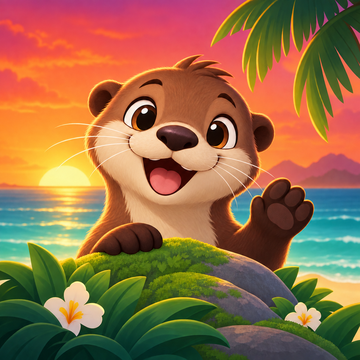
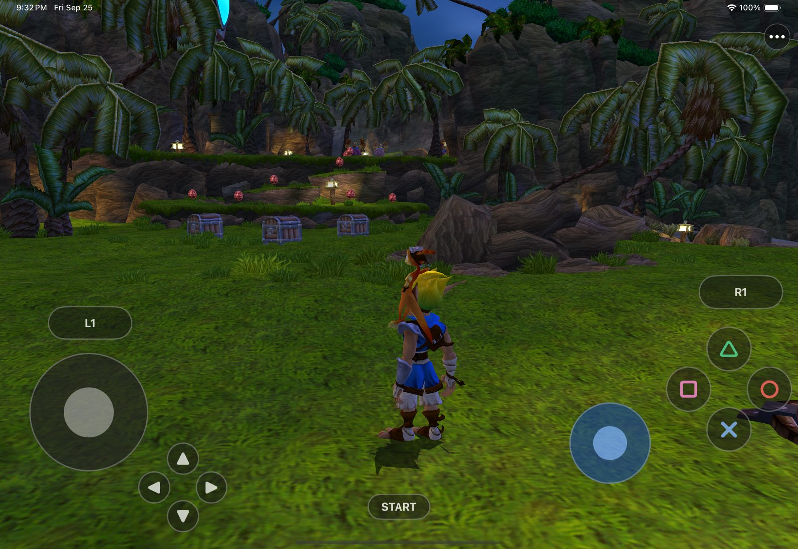
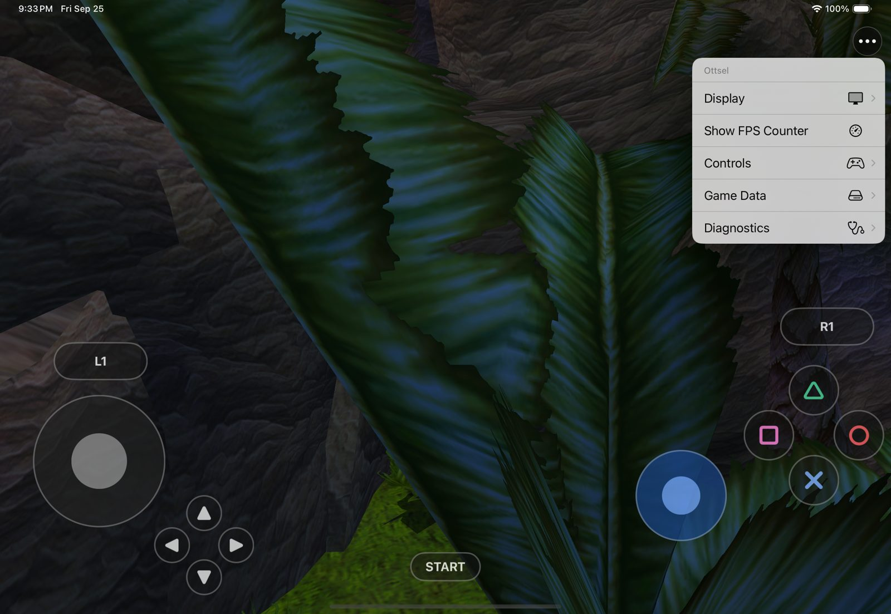
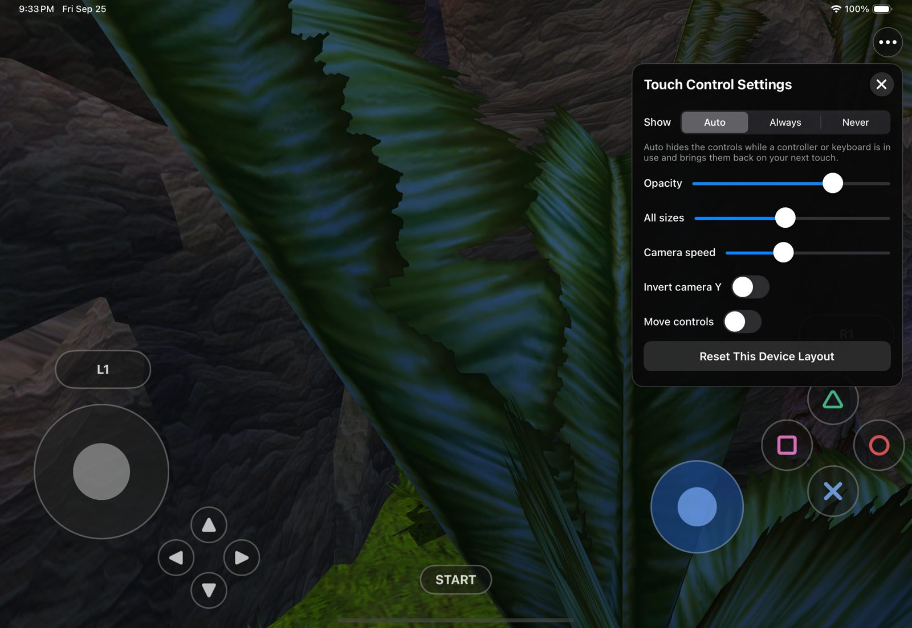
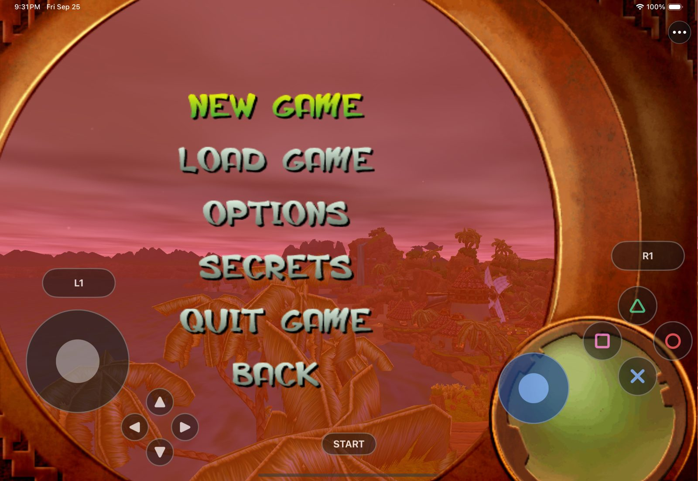
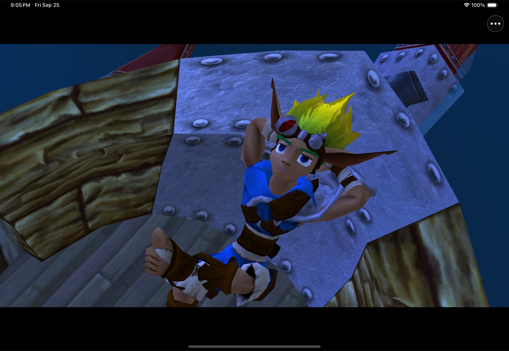

# Ottsel

  

  <strong>Jak and Daxter: The Precursor Legacy as a native iPad and iPhone app, built on OpenGOAL.</strong> 
  The game's own code compiled ahead of time to signed ARM64, OpenGOAL's renderer on Metal, touch controls with a floating move stick, and game data you supply from your own disc.

  
  
  
  
  
  

Ottsel packages [OpenGOAL](https://github.com/open-goal/jak-project), the open-source port of Jak and
Daxter rebuilt from its decompiled GOAL source, as a native iPadOS and iOS app. On a PC, OpenGOAL
compiles and links the game's code while it runs. iOS does not allow apps to create executable code, so
Ottsel compiles all 518 of the game's code modules to ARM64 on your Mac and signs them into the app. A
strict mode makes any attempt to load code at run time fatal, so the Simulator enforces the same rule an
iPad does. OpenGOAL's own OpenGL renderer draws the game through OpenGL ES 3.0, which
[ANGLE](https://chromium.googlesource.com/angle/angle) translates to Metal.

This repository contains the iOS app, one patch against a pinned OpenGOAL commit, and the build
scripts. It does **not** contain Jak and Daxter, a disc image, extracted game files, or saves.

> [!IMPORTANT]
> Ottsel is a developer preview. It plays in the iPad Simulator; it has not yet run on a physical iPad
> or iPhone, and there is no downloadable IPA. You build it yourself from your own disc on a Mac.

## What works

- **The whole opening.** New Game plays the full intro cutscene through to Geyser Rock, and Load Game
  restores a save into the training course.
- **Full speed in the Simulator.** The title, intro and training course run at about 58 fps at the iPad
  Pro 11-inch's native 2420×1668.
- **Touch controls that stay out of the way.** The move stick appears wherever your left thumb lands;
  buttons sit along the screen edges and respond to a sliding thumb.
- **Controllers and keyboards.** Apple game controllers and hardware keyboards work, and the touch
  controls hide while you use them.
- **A settings menu.** The **•••** button holds render resolution, an FPS counter, control settings,
  game-data import and diagnostics.
- **No JIT, ever.** Every piece of game code is compiled ahead of time and signed with the app.

## Current status

| Area | Current result |
|---|---|
| Game code | All 518 GOAL code modules compiled ahead of time to ARM64 and signed into the app; strict mode on |
| Rendering | OpenGOAL's OpenGL renderer on OpenGL ES 3.0 through ANGLE on Metal; about 58 fps at 2420×1668 in the Simulator |
| Play | The intro plays to Geyser Rock; Load Game restores a save into the training course; Jak walks, jumps and attacks by touch |
| Touch | Floating move stick, camera stick, D-pad, Cross, Circle, Square, Triangle, L1, R1 and Start, with haptics and a per-device layout |
| Settings | **•••** menu: Display (render resolution), FPS counter, Controls, Game Data import, Diagnostics |
| Controllers | Apple game controllers and hardware keyboards; the touch controls hide while either is in use |
| Sound | OpenGOAL's own IOP and OVERLORD sound code runs on iOS; audible playback on a device is not yet checked |
| Device build | The device build compiles, links and signs; `scripts/install-ios-device.sh` installs it on a connected iPad |

## Get started

You need:

- an Apple Silicon Mac with Xcode and its command-line tools;
- `brew install cmake ninja ripgrep glslang spirv-cross xcodegen`;
- for a physical device, an Apple ID signed in to Xcode (a free Personal Team is enough); and
- your own Jak and Daxter: The Precursor Legacy disc image, NTSC-U (`SCUS-97124`).

The build downloads a prebuilt ANGLE. Everything it generates stays under the ignored `out/` directory.

~~~sh
# 1. OpenGOAL at the pinned commit, plus Ottsel's patch
git clone https://github.com/chrissotraidis/ottsel && cd ottsel
git clone https://github.com/open-goal/jak-project out/jak-project
git -C out/jak-project checkout 641fb572e876750d8618434d9f7c1a531b43b366
git -C out/jak-project apply --binary ../../patches/ottsel-jak-project.patch

# 2. Host tools, your disc's data, and the game compiled for arm64
cd out/jak-project
cmake -S . -B build/h1 -G Ninja -DCMAKE_BUILD_TYPE=Release -DCMAKE_C_COMPILER=clang \
  -DCMAKE_CXX_COMPILER=clang++ -DSTATICALLY_LINK=OFF -DINSTALL_GTEST=OFF -DOTTSEL_NO_EMIT=ON
ninja -C build/h1 goalc extractor ottsel-a11-slice
./build/h1/decompiler/extractor --extract --decompile /path/to/jak1.iso   # -> iso_data/jak1, out/jak1/fr3
./build/h1/goalc/goalc --game jak1 --isa arm64 -c '(mi)'                  # -> out/jak1/iso, out/jak1/obj
cd ../..

# 3. The app (Simulator; add OTTSEL_PLATFORM=device for iPad or iPhone)
OTTSEL_STRICT_EXEC=1 OTTSEL_SIGNED_GSTATE_EXPERIMENT=0 OTTSEL_SIGNED_EXPORT_BANKS=1 \
  OTTSEL_SIGNED_MODULE_LIST=config/signed-game-strict.json bash scripts/build-ios.sh

# 4. A game-data pack from your disc, outside the repository
scripts/prepare-user-data-pack.sh out/jak-project/iso_data/jak1 /tmp/ottsel-pack out/jak-project/out/jak1/fr3
~~~

The first build takes about 12 minutes on an 8-core M-series Mac; later builds compile only what
changed and take a few minutes.

## First launch

**In the Simulator,** install the app, copy your pack into it, and launch:

~~~sh
xcrun simctl install booted out/jak-project/out/ios/app/OttselShell.app
scripts/import-ios-user-data.sh <simulator-udid> /tmp/ottsel-pack
xcrun simctl launch booted com.ottsel.shell
~~~

**On an iPad or iPhone,** sign in to Xcode with an Apple ID, connect and trust the device, and turn on
Developer Mode. Then run `scripts/install-ios-device.sh /tmp/ottsel-pack`. It finds your signing
identity, has Xcode create a development profile if needed, builds the device app, installs it, copies
the pack into the app, and launches it.

You can also move a pack onto a device yourself: put the pack folder in Files, open **••• → Game Data →
Import Game Data…**, choose the folder, then close and reopen Ottsel. The app checks the pack on launch
and keeps it for later launches.

## Touch controls

The layout follows [SunPad](https://github.com/chrissotraidis/sunpad): controls sit at the screen edges
so the middle of the picture stays clear.

- **Left:** L1 and the D-pad at the top. Below them, the move stick appears wherever your thumb lands
  and follows it if you drag past the rim, so there is no exact spot to find.
- **Right:** the Cross, Circle, Square and Triangle diamond, R1, and the camera stick.
- **Bottom centre:** Start.
- **Menu:** the **•••** button opens Display, Show FPS Counter, Controls, Game Data and Diagnostics.
- **Customise:** **Controls → Touch Control Settings…** sets when the controls show (Auto, Always,
  Never), whether the move stick follows your thumb or stays in one place, opacity, size, camera speed
  and camera inversion. **Move Touch Controls** lets you drag and resize each control; the layout is
  saved per device.

Buttons respond to a finger sliding onto them, so a thumb can roll from Cross to Square without lifting.

<table>
  <tr>
    <td width="50%"></td>
    <td width="50%"></td>
  </tr>
  <tr>
    <td align="center"><strong>Three-dot menu</strong> Display, controls, game data and diagnostics.</td>
    <td align="center"><strong>Touch Control Settings</strong> Visibility, floating stick, opacity, size and camera.</td>
  </tr>
</table>

## Controllers and keyboards

Apple game controllers work as a PlayStation pad would. A hardware keyboard uses OpenGOAL's layout, with
W/A/S/D to move, I/J/K/L for the camera, Space/E/F/R for Cross/Circle/Square/Triangle, Return for Start
and Tab for Select. With **Show** set to Auto, the touch controls hide while a controller or keyboard is
in use and come back on your next touch.

## Performance

In the iPad Pro 11-inch (M4) Simulator, the title screen, the intro and the training course hold about
58 fps at the full 2420×1668, with the renderer spending about 6.5 ms per frame on the CPU. The
Simulator is not a device, so the real numbers wait for hardware. **••• → Display → Render Resolution**
lowers the internal resolution if a device needs it, and **••• → Show FPS Counter** shows the frame rate.

## Screenshots

<table>
  <tr>
    <td width="50%"></td>
    <td width="50%"></td>
  </tr>
  <tr>
    <td align="center"><strong>Menus by touch</strong> The D-pad, Cross and Start drive every menu.</td>
    <td align="center"><strong>The whole intro plays</strong> OpenGOAL's cutscenes, start to finish, on iOS.</td>
  </tr>
</table>

All screenshots come from the iPad Pro 11-inch (M4) Simulator, using game data from a disc owned by the
person running it.

## Supported game data

| Disc | Region | Status |
|---|---|---|
| `SCUS-97124` | NTSC-U | The only disc tested |

OpenGOAL supports other releases of the game; Ottsel has not been tested with them.

## How it fits together

~~~text
Your Jak and Daxter disc image (on the Mac)
        ↓  OpenGOAL extractor and decompiler
Game data + OpenGOAL's GOAL source
        ↓  goalc compiles the game for arm64; build-ios.sh signs all 518 modules into the app,
        ↓  translates the 92 shaders to GLSL ES and embeds ANGLE
Ottsel app (Simulator or device)  +  your game-data pack
        ↓
OpenGOAL runtime → OpenGL ES 3.0 → ANGLE → Metal
~~~

The app you build also contains a few files generated from your disc (the compiled `KERNEL.CGO` and
`GAME.CGO`, the title and village DGO files, and the text files). It is for your own devices only.

## Roadmap

1. **Run on a physical iPad**, reaching the training course from a cold launch.
2. **Measure the frame rate on that iPad** over five minutes of play, aiming for a steady 30 fps or
   better, and tune from on-device profiles.
3. **A 20-minute playtest** from New Game through Sandover Village and a neighbouring level, with touch
   and a controller, saving and continuing, sound, and backgrounding the app.
4. **Fix what the playtest finds**, most painful first.
5. **iPhone**, the same checks on a physical iPhone.
6. **A shareable build**, once every game-derived file lives in your pack, so the app itself carries no
   game data.

The detailed plan is in [`docs/GOAL_LOOP.md`](docs/GOAL_LOOP.md) and the running log in
[`docs/STATUS.md`](docs/STATUS.md).

## Known limitations

- Nothing has run on a physical device yet; frame rate, sound, heat and battery on hardware are unknown.
- Only the intro, Geyser Rock and the training course have been checked; later levels have not been
  played through.
- The iPhone layout has not been checked.
- Building needs a Mac, Xcode and your own disc; there is no IPA.
- The app you build contains files generated from your disc, so it must not be shared.

## Frequently asked questions

### Does this repository include Jak and Daxter?

No. You need your own disc image. Please do not open issues asking for game data or download links.

### Is Ottsel an emulator?

No. OpenGOAL runs the game's own GOAL code natively; it does not emulate a PlayStation 2. Ottsel makes
that code run on iOS by compiling it ahead of time, and adapts OpenGOAL's renderer, input and file access
to the platform.

### Does it use a JIT?

No. There is no JIT, no memory that is both writable and executable, and no code patching at run time.
Every piece of game code is ARM64 compiled on the Mac and signed with the app.

### Can I download an IPA?

Not yet. The app you build contains files generated from your disc, so it cannot be shared. A public
build waits until all of those files move into the pack.

### Does it run on a real iPad or iPhone?

It has not been tested on one yet. The device build compiles, links and signs, and
`scripts/install-ios-device.sh` installs it. If you try it, please file a
[device report](https://github.com/chrissotraidis/ottsel/issues/new?template=device_report.yml).

## Project map

| Path | Purpose |
|---|---|
| [`src/shell/`](src/shell/) | The iOS app: window, boot, touch controls, the three-dot menu and the app icon |
| [`patches/ottsel-jak-project.patch`](patches/ottsel-jak-project.patch) | Every change to the pinned OpenGOAL commit ([how to refresh it](patches/README.md)) |
| [`scripts/build-ios.sh`](scripts/build-ios.sh) | Builds SDL, zstd and the runtime; signs the game modules; translates shaders; assembles the app |
| [`scripts/install-ios-device.sh`](scripts/install-ios-device.sh) | Signs, installs and launches on a connected iPad or iPhone, and copies the pack |
| [`scripts/prepare-user-data-pack.sh`](scripts/prepare-user-data-pack.sh) | Builds a game-data pack from your extracted disc, outside the repository |
| [`scripts/import-ios-user-data.sh`](scripts/import-ios-user-data.sh) | Copies a pack into a Simulator install |
| [`scripts/translate-gl-shaders.py`](scripts/translate-gl-shaders.py) | Translates OpenGOAL's desktop shaders to GLSL ES 3.00 |
| [`scripts/test-ios-touch.sh`](scripts/test-ios-touch.sh) | Plays title → Load Game → training course with real touches (XCUITest) |
| [`scripts/replay-ios-normal-route.py`](scripts/replay-ios-normal-route.py) | Drives the menus into New Game or a saved slot for quick checks |
| [`config/`](config/) | Signed-module lists for the build profiles |
| [`docs/`](docs/) | The plan, the status log, per-milestone evidence and the original research |
| [`jak1-researchloop.md`](jak1-researchloop.md) | The original project brief |

## Contributing

The most useful contribution right now is a
[device report](https://github.com/chrissotraidis/ottsel/issues/new?template=device_report.yml) from a
physical iPad or iPhone: the device, iOS version, how far it got, and the frame rate from **••• → Show FPS
Counter**. For problems building or running, use the
[bug report](https://github.com/chrissotraidis/ottsel/issues/new?template=bug_report.yml) form. Changes to
OpenGOAL go through `patches/ottsel-jak-project.patch`; refresh it with
`scripts/snapshot-jak-project.sh write`. Never attach game data, extracted files, a built app or saves.

## Credits

Ottsel stands on [OpenGOAL](https://github.com/open-goal/jak-project), whose team decompiled the game,
wrote the GOAL compiler and runtime, and built the renderer Ottsel uses. ANGLE comes from
[kivy/angle-builder](https://github.com/kivy/angle-builder) releases. [SDL](https://github.com/libsdl-org/SDL)
provides the window and input, and [glslang](https://github.com/KhronosGroup/glslang) with
[SPIRV-Cross](https://github.com/KhronosGroup/SPIRV-Cross) translate the shaders at build time. The
touch controls and menu follow [SunPad](https://github.com/chrissotraidis/sunpad). See
[`THIRD_PARTY_NOTICES.md`](THIRD_PARTY_NOTICES.md) for every component and its license.

## Legal

Ottsel is an unofficial community project and is not affiliated with or endorsed by Sony Interactive
Entertainment or Naughty Dog. Jak and Daxter names and screenshots are used only to identify the game
and show the project working. No disc image, extracted game file or save is included in this
repository. The Ottsel icon is original artwork, not a character from the game. OpenGOAL is released
under the ISC License, and each other component keeps its own license.
