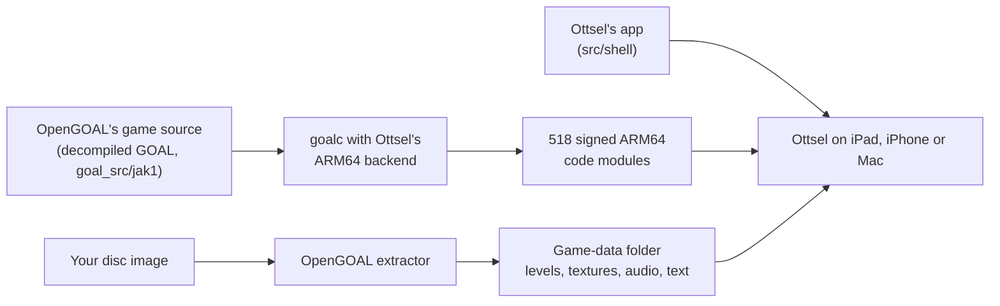

# Ottsel

<p align="center">
  <strong>A native iPad, iPhone and Mac port of Jak and Daxter: The Precursor Legacy, built on OpenGOAL's decompilation of the game.</strong><br>
  Naughty Dog's original game code, decompiled into source by OpenGOAL and compiled ahead of time to signed ARM64. No emulator, no JIT. Touch controls, controllers, TV output, cheats, texture packs and a Play as Mario mod.
</p>

<p align="center">
  
  
  <a href="https://github.com/open-goal/jak-project"></a>
  
  
  
  
  <a href="LICENSE"></a>
  
  <a href="https://github.com/chrissotraidis/padmint"></a>
  <a href="https://discord.gg/xwHfUD2bxW"></a>
</p>


> [!IMPORTANT]
> **Bring your own disc.** Ottsel builds from your own disc image of *Jak and Daxter: The Precursor
> Legacy* for PlayStation 2: **USA, `SCUS-97124`, the original Black Label release**. The build checks
> the disc and stops on the Greatest Hits, PAL, Japanese and Korean versions
> ([which disc exactly](#which-disc-you-need)). This repository contains no disc image, extracted game
> files or saves.
>
> **Developer preview.** Ottsel runs on a physical iPad Pro 12.9-inch (M2) at the iPad's full resolution
> and 60 fps, by touch or with a controller, and on Apple Silicon Macs. It has not run on a physical iPhone
> yet. There is no download: you build your own copy on an Apple Silicon Mac, with
> [PadMint](#build-your-own-with-padmint) or the scripts in this repository.
>
> **AI disclosure:** Ottsel uses substantial AI assistance for code, tests, documentation, debugging and
> maintenance. There is no audited percentage of AI-generated code. Status and test records describe
> what was checked. This disclosure concerns Ottsel's workflow, not the authorship of OpenGOAL.

## What is Ottsel?

Ottsel is a **decompilation port**. The [OpenGOAL](https://github.com/open-goal/jak-project) project
decompiled Jak and Daxter's PlayStation 2 code back into readable source and rebuilt the game natively for
PC. Ottsel compiles that same source for iPad, iPhone and Mac and wraps it in an app made for them.

| Question | Answer |
| --- | --- |
| Is it a decompilation? | Yes. The game's code is OpenGOAL's decompiled source of Naughty Dog's original code, compiled for Apple's ARM64 chips |
| Is it an emulator? | No. Nothing emulates a PlayStation 2; the game runs as native code |
| Is it a static recompilation? | No. Static recompilations such as [BlueWake](https://github.com/chrissotraidis/bluewake) translate a disc's machine code directly. Ottsel compiles human-readable source |
| Is it a remake? | No. The gameplay is the original game's own logic; only the parts that once talked to PS2 hardware (graphics, sound, input, memory card) are OpenGOAL's replacements |
| Who made what? | OpenGOAL's team decompiled the game and wrote its compiler, runtime and renderer. Ottsel adds the ARM64 compiler backend, the signed-code loader that iOS requires, and the iPad, iPhone and Mac app |
| Is the game in this repository? | No. The decompiled source comes from OpenGOAL's repository when you build, and the levels, textures, music and voices come from your own disc |

## How Ottsel works

Naughty Dog wrote Jak and Daxter in GOAL, their own Lisp-based language, and shipped it as compiled
PlayStation 2 code. OpenGOAL turned that compiled code back into readable GOAL source with a decompiler,
cleaned it up by hand, and wrote a new GOAL compiler, a C++ runtime and an OpenGL renderer so it runs
natively on PC.

Ottsel takes that to iPad, iPhone and Mac. OpenGOAL normally compiles and loads the game's code while it
runs, and iOS does not allow an app to create executable code. Ottsel therefore compiles all of it to
ARM64 on your Mac, ahead of time, and signs every module into the app like ordinary app code; loading
code at run time is fatal by design. OpenGOAL's renderer runs on Metal through ANGLE, and Ottsel wraps
the game in an app: touch controls, controller and keyboard input, TV output, the ••• menu (the menu bar
on a Mac), saves and logging.

Your disc supplies everything that is art and data rather than code: levels, textures, models, music,
sound and text. OpenGOAL's extractor pulls these out of your disc image on your Mac, and they travel to
your device in a game-data folder that never enters this repository.



| Piece | Where it comes from |
| --- | --- |
| The game's code (534 decompiled GOAL source files) | OpenGOAL's repository at a pinned commit, fetched by the build into `out/` |
| Ottsel's changes to OpenGOAL | [`patches/ottsel-jak-project.patch`](patches/ottsel-jak-project.patch): the ARM64 compiler backend, the signed-module loader, the iOS and Mac runtime, renderer, sound and input work, and small changes to 30 of the game's GOAL files |
| The app | [`src/shell/`](src/shell/): boot, touch controls, the ••• menu and Mac menu bar, TV output, the Mario mod, logging and the icon |
| Levels, textures, audio and text | Your disc, through OpenGOAL's extractor, into your game-data folder |
| Mario, for Play as Mario | [libsm64](https://github.com/libsm64/libsm64) at a pinned commit with [`patches/libsm64-ottsel-pose.patch`](patches/libsm64-ottsel-pose.patch); his animations, textures and voice come from your own Super Mario 64 ROM when you play |
| OpenGL ES on Metal | [ANGLE](https://chromium.googlesource.com/angle/angle), downloaded prebuilt by the build |

This repository holds Ottsel's own code, its build scripts and its patches. Everything else is fetched,
downloaded or extracted from your disc when you build.

## Get Ottsel

| You play on | Status | What to do |
| --- | --- | --- |
| **iPad** | Runs on an iPad Pro 12.9-inch (M2) at 60 fps | [Build your own](#build-your-own-with-padmint), then install it with Sideloadly or Xcode |
| **iPhone** | The same app; tested in the Simulator, not yet on a physical iPhone | Same as iPad |
| **Mac** (Apple silicon) | Runs at 60 fps on an M3 Max; not yet played start to finish | [Build your own](#build-your-own-with-padmint) Mac app |
| Ready-made download | Not available | The app you build holds files made from your disc. **It is yours alone: never share or upload it.** |

**Need help or found a bug?** Join the [Discord](https://discord.gg/xwHfUD2bxW), use
**••• → Help & Feedback → Report a Problem** in the app, or open a
[device report](https://github.com/chrissotraidis/ottsel/issues/new?template=device_report.yml) or
[bug report](https://github.com/chrissotraidis/ottsel/issues/new?template=bug_report.yml). A report from
an iPad, iPhone or Mac not listed here is the most useful thing you can send right now.

## Which disc you need

| | What Ottsel needs | Details |
| --- | --- | --- |
| **Jak and Daxter** | Your own PS2 disc image (`.iso`): *Jak and Daxter: The Precursor Legacy*, USA, serial `SCUS-97124`, the original Black Label release (OpenGOAL calls it `ntsc_v1`) | Tested with `Jak and Daxter - The Precursor Legacy (USA) (En,Fr,De,Es,It).iso`: 1,460,535,296 bytes, SHA-256 `139086ffd50b5713ea71d3faa3d4cb1793291e3c575c0fb5418131d116481e7b`. The build checks the game's files rather than the image's hash, so another clean dump of the same disc should work too |
| Not supported yet | Greatest Hits (also `SCUS-97124`, OpenGOAL `ntsc_v2`), PAL (`SCES-50361`), Japan (`SCPS-15021`), Korea (`SCPS-56003`) | The build stops with a message naming the disc it needs |
| **Super Mario 64** (optional) | Your own US ROM (`.z64`, `.v64` or `.n64`, 8 MB) | Only for **Play as Mario**, added in the app, never at build time. Tested with the US `.z64` whose SHA-1 is `9bef1128717f958171a4afac3ed78ee2bb4e86ce` |

## Build your own with PadMint

**No Mac?** Building Ottsel for iPhone or iPad needs an Apple Silicon Mac today.
Ottsel reads your own disc image while it builds, so it can't use [GitHub's
Mac](https://github.com/chrissotraidis/padmint#no-mac-build-on-githubs-mac) the
way some other ports do: that would mean uploading your game file. A Windows
build is planned; [PadMint's Windows
list](https://github.com/chrissotraidis/padmint/blob/main/docs/WINDOWS.md) shows
where it stands.

[PadMint](https://github.com/chrissotraidis/padmint) builds Ottsel on an Apple Silicon Mac from your own
disc. It makes two things: the app (an `.ipa` for iPhone and iPad, or a zipped Mac app) and an
**Ottsel game data** folder made from your disc, which you import in the app once.

You need:

- a Mac with Apple silicon, full Xcode with its iOS platform, and about 20 GB of free space
- `brew install cmake ninja ripgrep glslang spirv-cross`
- your disc image ([which one](#which-disc-you-need))
- for iPhone and iPad: iOS or iPadOS 18.5 or later with Developer Mode on, and an Apple ID to sign the
  app with Sideloadly or Xcode (a free Apple ID works, but its apps expire after seven days)

Download [PadMint](https://github.com/chrissotraidis/padmint/releases/latest) (0.5.2 or newer), unzip it,
double-click `PadMint.command`, choose Ottsel and your disc image, and click **Make my copy**.

> [!NOTE]
> To run the same recipe ([`padmint.json`](padmint.json)) by hand, use a checkout of PadMint and of this
> repository:
>
> ```sh
> git clone https://github.com/chrissotraidis/padmint
> git clone https://github.com/chrissotraidis/ottsel
> cd padmint
> python3 -m padmint build ottsel --target ios --repo ../ottsel \
>   --revision "$(git -C ../ottsel rev-parse HEAD)" --disc "/path/to/your/jak1.iso"
> ```
>
> Use `--target macos` for the Mac app. PadMint prints where it saved the app; the game-data folder sits
> beside it with `.data` added to the name.

**On iPhone or iPad:**

1. Install the `.ipa` with [Sideloadly](https://sideloadly.io), AltStore or Xcode.
2. Copy the game-data folder to the device: iCloud Drive, a USB drive, or Finder (select the device,
   open **Files** and drag the folder onto **Ottsel**).
3. Open Ottsel, choose **••• → Game Data → Import Game Data…**, pick that folder, then close and reopen
   Ottsel. It checks the folder on launch and keeps it.

**On a Mac:** unzip the app, move **Ottsel** to Applications and open it. Choose **Game Data → Import Game
Data…** in the menu bar, pick the game-data folder, then quit and reopen Ottsel.

Install updates over the existing app (on iPhone and iPad, with the same Apple ID): your saves, settings
and game data stay. Deleting the app deletes its saves.

## Playing

[Frequently asked questions](#frequently-asked-questions) · [Mods, texture packs and cheats](docs/MODS.md) · [Current status](docs/STATUS.md)

- **Touch controls.** The move stick appears wherever your left thumb lands and follows it; L1/L2,
  R1/R2, the D-pad, the face buttons, START and the camera stick sit at the screen edges and respond to a
  sliding thumb. **••• → Touch Controls** sets when they show, their opacity and size, and lets you drag
  and resize each one.
- **Controllers and keyboards.** Xbox, PlayStation and other Apple-supported controllers work like a
  PlayStation pad; hardware keyboards use OpenGOAL's layout (W/A/S/D, I/J/K/L camera, Space/E/F/R, Return
  for Start). The touch controls hide as soon as you use either and come back on your next touch or when
  the controller disconnects.
- **Play on a TV.** Connect a TV or monitor over HDMI or USB-C, or use AirPlay: the game fills it at the
  display's resolution and the iPad becomes the controller. Unplug and the game returns to the iPad.
- **Cheats.** **••• → Cheats** switches OpenGOAL's cheats on in one tap: invincibility, infinite eco,
  big and huge heads, big fist, blue Daxter, mirror world and more. The original button codes work too.
- **Saves and interruptions.** Save from the pause menu as on the PS2; Load Game resumes after a
  relaunch. Leaving the app pauses the game and its sound, and you come back to the pause menu.
- **Help and logs.** **••• → Help & Feedback** opens a GitHub device report with your device, OS version
  and frame rate filled in, shares the app's logs, and links the Discord and this repository.
- **Play as Mario.** **••• → Mods → Play as Mario** draws Super Mario 64's Mario in Jak's place, with his
  animations and voice, from your own US Super Mario 64 ROM. Jak still plays the game underneath, so every
  control, eco power and level works as before; **Mario's Moves** adds his triple jump and sideflip. See the
  [mods guide](docs/MODS.md#play-as-mario).
- **Texture packs.** `scripts/apply-texture-pack.sh` builds a data pack with any OpenGOAL-format texture
  pack. See the [mods guide](docs/MODS.md).

The ••• menu holds Display (render resolution, FPS counter), Cheats, Mods, Touch Controls, Game Data,
Help & Feedback, and Diagnostics (log overlay, jump to a level for testing). On the Mac the same menus
are the menu bar, and the keyboard, mouse and controllers play ([Mac guide](docs/macos-settings-and-packaging.md)).

<table>
  <tr>
    <td width="50%"></td>
    <td width="50%"></td>
  </tr>
  <tr>
    <td align="center"><strong>The ••• menu</strong><br>Settings, cheats, game data and help.</td>
    <td align="center"><strong>Touch Control Settings</strong><br>Visibility, floating stick, opacity, size and camera.</td>
  </tr>
  <tr>
    <td width="50%"></td>
    <td width="50%"></td>
  </tr>
  <tr>
    <td align="center"><strong>On a TV</strong><br>The game at the display's resolution.</td>
    <td align="center"><strong>The iPad as controller</strong><br>Touch controls and menu stay on the iPad.</td>
  </tr>
</table>


## What has been tested

**On a physical iPad** (iPad Pro 12.9-inch, 6th generation, M2, iPadOS 27.0.1;
[evidence](docs/evidence/G2/g2-first-ipad-hardware-run-2026-10-10.md)):

| Area | Result |
| --- | --- |
| Boot and play | Data pack imported on first launch; the intro, Geyser Rock and Sandover play with every code module signed and no faults |
| Frame rate | 2732×2048, 60 fps for 98.5% of a 29-minute session |
| Sound | Music, effects, voice hints and cutscene dialogue all play; voice hints no longer silence the rest of the game |
| Input | Touch and an Xbox Series X controller both play; the touch controls hide and return with the controller, and can be moved and resized |
| Saves | OpenGOAL PC saves copied onto the iPad fill slots 2–4 (the Citadel, Rock Village and Volcanic Crater, all with 100 power cells); Rock Village loads and plays at 60 fps |
| Play as Mario | Mario drawn in Jak's place with his voice and shadow while Jak's controls and powers play the game; still being tuned |
| Updates | Reinstalling over the app keeps saves and settings |

**On a Mac** (M3 Max, macOS 26.6): the same app with the menu bar plays Geyser Rock with Mario at a steady
60 fps at 2560×1920, and quits cleanly. Another GPU-heavy app running at the same time cut it to 25–45 fps,
and hand play has shown uneven frame pacing that is still being looked into.

**In the Simulators** (iPad Pro 11-inch M4 and iPhone 16 Pro, native resolution):

| Area | Result |
| --- | --- |
| Levels | All 16 hubs and levels load and run at 51–60 fps (2420×1668; 12 of 16 hold 60) with no faults |
| Saves | Saving in Sandover, quitting, relaunching and loading resumes in Sandover |
| Sound | Music, effects and dialogue mix and play; a recorded minute showed no clipping or dropouts |
| TV output | 1080p external display from a cold launch, unplugged and replugged mid-game |
| Touch | A scripted real-touch run plays title → Load Game → the saved level, walks, jump-attacks, and opens the ••• menu and the layout editor |
| iPhone | Boots to the title with the full touch layout fitted to the screen |

**With PadMint** (0.5.0): PadMint's player check (Apple's Python 3.9, an empty PadMint folder and a fresh
clone) built the iPhone/iPad IPA from scratch in 22 minutes on an M3 Max. It passed PadMint's IPA check and
publication gate and carries no provisioning profile, and its game-data folder validated. A PadMint Mac build
made a zipped app that opens and plays the intro. Sideloading a PadMint-built IPA onto a device has not been
tried yet.

Not yet tested: a physical iPhone, a real HDMI adapter or AirPlay, long sessions (heat and battery), a full
play-through on a device, a sideloaded PadMint-built app, and Developer ID signing for other people's Macs.

## Build from source

PadMint runs the stages of [`scripts/build-personal.sh`](scripts/build-personal.sh); you can run them
yourself with the same tools as above. Everything the build generates stays in the ignored `out/` folder;
keep your disc image outside the repository or in the ignored `ref/` folder.

~~~sh
git clone https://github.com/chrissotraidis/ottsel && cd ottsel
scripts/build-personal.sh preflight ios                     # or macos
scripts/build-personal.sh source                            # OpenGOAL at the pinned commit, plus the patch
scripts/build-personal.sh tools                             # goalc and the extractor
scripts/build-personal.sh extract "/path/to/your/jak1.iso"  # checks the disc, then extracts it
scripts/build-personal.sh compile                           # the game's code, compiled to ARM64
scripts/build-personal.sh pack /tmp/ottsel-pack             # the game-data folder
~~~

`extract` reads your disc's levels, textures and text (the game's code is already source in OpenGOAL),
and `compile` compiles the game's GOAL source to ARM64. A first build takes about 10 to 15 minutes on an
M-series Mac; later builds take a few minutes.

**Straight onto an iPad or iPhone:** connect the device by cable, trust the Mac, turn on Developer Mode,
`brew install xcodegen`, then run `scripts/install-ios-device.sh /tmp/ottsel-pack`. It finds your signing
identity and a development profile (creating one through Xcode if needed), builds and signs the app,
installs it, copies your pack in and launches it.

**An unsigned IPA** for Sideloadly: `scripts/build-personal.sh app ios`, then
`scripts/build-personal.sh package ios ~/Desktop/Ottsel.ipa`.

**Mac:** `scripts/build-personal.sh app macos`, then open `out/jak-project/out/macos/app/Ottsel.app` and
choose your pack with **Game Data → Import Game Data…**. It is signed ad hoc, so it runs on the Mac that
built it; see the [Mac guide](docs/macos-settings-and-packaging.md).

**Simulator:** build with
`OTTSEL_STRICT_EXEC=1 OTTSEL_SIGNED_GSTATE_EXPERIMENT=0 OTTSEL_SIGNED_EXPORT_BANKS=1 OTTSEL_SIGNED_MODULE_LIST=config/signed-game-strict.json scripts/build-ios.sh`,
then `xcrun simctl install booted out/jak-project/out/ios/app/OttselShell.app`,
`scripts/import-ios-user-data.sh <udid> /tmp/ottsel-pack` and `xcrun simctl launch booted com.ottsel.shell`.

**Logs:** the app writes `ottsel-runtime.log` and `ottsel-fault.log` to
`Library/Application Support/local.ottsel/OttselShell/` in its container (on a Mac, under your home
folder). Share them from **••• → Help & Feedback → Share Logs…**, or copy them to the Mac with
`xcrun devicectl device copy from`.

## Frequently asked questions

<details>
<summary>Does this repository include Jak and Daxter?</summary>

No. You need your own disc image. The game's code comes from OpenGOAL's open-source repository when you
build, and its art, sound and levels come from your disc. Please do not ask for game data or download
links in issues or on Discord.

</details>

<details>
<summary>Is this a decompilation or an emulator?</summary>

A decompilation. OpenGOAL decompiled Naughty Dog's GOAL code into source and rebuilt the compiler and
runtime around it; Ottsel compiles that source to ARM64 ahead of time, so the original game's code runs
natively. Nothing emulates a PlayStation 2, and there is no JIT, no writable-and-executable memory and no
code patching at run time. See [What is Ottsel?](#what-is-ottsel).

</details>

<details>
<summary>Can I download an IPA or a Mac app?</summary>

No. The app you build contains files generated from your disc (the compiled `KERNEL.CGO` and
`GAME.CGO`, the title and village DGO files, and the text files), so it is for your own devices only.
PadMint builds your own on an Apple Silicon Mac. A shareable build waits until all of those move into the
game-data folder.

</details>

<details>
<summary>I have the Greatest Hits or a PAL disc. Will it work?</summary>

Not yet. Ottsel compiles the game for the original USA Black Label release, and the build stops on any
other version rather than make an app that misbehaves. OpenGOAL itself supports the other releases, so
they are possible later.

</details>

<details>
<summary>Can I play on a TV?</summary>

Yes, by design: connect a TV or monitor over HDMI or USB-C, or use AirPlay, and the game moves to it at
the display's resolution while the iPad keeps the controls; a paired controller works too. This has been
tested with the Simulator's external display; a real adapter has not been tried yet.

</details>

<details>
<summary>Can I use mods, texture packs, cheats or a higher frame rate?</summary>

Cheats are built in (**••• → Cheats**). Texture packs and replacement models go into your data pack on
the Mac; code mods and custom levels each need their own build. The [mods guide](docs/MODS.md) covers all
three, and **Play as Mario** (**••• → Mods**, with your own Super Mario 64 ROM). The game runs at 60 fps;
OpenGOAL's experimental 100 and 150 fps modes can break Jak 1's
physics, so Ottsel does not offer them.

</details>

<details>
<summary>How do I test a later level without playing up to it?</summary>

**••• → Diagnostics → Jump to Level (Testing)** starts play at any hub or level, the way the game respawns
Jak, keeping your progress. It does not unlock anything, and some cutscenes and tasks expect the normal
order.

</details>

<details>
<summary>Can I use my OpenGOAL saves from a PC?</summary>

Yes. OpenGOAL keeps each Jak 1 save slot as two files in its `saves/BASCUS-97124AYBABTU!` folder: slot 1
is `bank0.bin` and `bank1.bin`, slot 2 is `bank2.bin` and `bank3.bin`, and so on up to slot 4. Copy them
into the same folder in Ottsel's container, for example with
`xcrun devicectl device copy to --domain-type appDataContainer --domain-identifier com.ottsel.shell` and the
destination `Library/Application Support/local.ottsel/OttselShell/OpenGOAL/jak1/saves/BASCUS-97124AYBABTU!/`.
Renaming a pair moves it to another slot. They appear under **Load Game** the next time Ottsel starts.

</details>

<details>
<summary>Why does the music stop in menus?</summary>

The game pauses music and effects whenever its pause or main menu is open, as it did on the PS2. It
resumes when you close the menu.

</details>

<details>
<summary>Is everything finished?</summary>

No. Still open: a physical iPhone; long iPad sessions with their heat and battery; a real HDMI adapter
and AirPlay; a full play-through past the opening (tasks, bosses and vehicle sections) on a device;
smoother Mac frame pacing and Developer ID signing; a fresh-Mac PadMint build and a sideloaded
PadMint-built app; and a shareable build. The plan is in [`docs/GOAL_LOOP.md`](docs/GOAL_LOOP.md) and the
running log in [`docs/STATUS.md`](docs/STATUS.md).

</details>

## Repository layout and contributing

| Path | Purpose |
| --- | --- |
| [`src/shell/`](src/shell/) | The app: boot, touch controls, the ••• menu and Mac menu bar, TV output, the Mario mod, logging and the icon |
| [`patches/`](patches/) | Every change to the pinned OpenGOAL and libsm64 commits ([refreshing them](patches/README.md)) |
| [`padmint.json`](padmint.json) | PadMint's recipe: the stages below, for iPhone/iPad and Mac |
| [`scripts/build-personal.sh`](scripts/build-personal.sh) | Builds your own app and game-data folder from your disc, one stage at a time |
| [`scripts/build-ios.sh`](scripts/build-ios.sh) | Builds the runtime, signs the game modules, translates shaders, assembles the app (Simulator, device or Mac) |
| [`scripts/install-ios-device.sh`](scripts/install-ios-device.sh) | Builds, signs, installs and launches on a connected iPad or iPhone |
| [`scripts/prepare-user-data-pack.sh`](scripts/prepare-user-data-pack.sh) | Builds a game-data folder from your extracted disc |
| [`scripts/apply-texture-pack.sh`](scripts/apply-texture-pack.sh) | Builds a game-data folder with a texture pack applied |
| [`scripts/test-ios-touch.sh`](scripts/test-ios-touch.sh) | Plays title → Load Game → training course with real touches |
| [`config/`](config/) | Which game modules are compiled and signed into the app |
| [`docs/`](docs/) | The plan, the status log, evidence for each tested gate, the mods and Mac guides and the original research |

Changes to OpenGOAL go through `patches/ottsel-jak-project.patch`; refresh it with
`scripts/snapshot-jak-project.sh write`. For a bug report, include the exact commit, device, OS version
and steps. Never attach game data, extracted files, a built app, ROMs or saves.

## Credits and license

Ottsel stands on [OpenGOAL](https://github.com/open-goal/jak-project), whose team decompiled the game,
wrote the GOAL compiler and runtime, and built the renderer Ottsel uses. ANGLE comes from
[kivy/angle-builder](https://github.com/kivy/angle-builder); [SDL](https://github.com/libsdl-org/SDL)
provides the window and input; [glslang](https://github.com/KhronosGroup/glslang) and
[SPIRV-Cross](https://github.com/KhronosGroup/SPIRV-Cross) translate the shaders;
[libsm64](https://github.com/libsm64/libsm64) (CC0) brings Mario for the Play as Mario mod. The touch
controls and menu follow [SunPad](https://github.com/chrissotraidis/sunpad) and
[BlueWake](https://github.com/chrissotraidis/bluewake). See
[`THIRD_PARTY_NOTICES.md`](THIRD_PARTY_NOTICES.md) for every component and its license.

Ottsel is released under the [ISC License](LICENSE), the same license as OpenGOAL, so its changes can flow
back upstream; the patch's changes to OpenGOAL's files stay under OpenGOAL's license and copyright.
Ottsel is an unofficial community project and is not affiliated with or endorsed by Sony Interactive
Entertainment, Naughty Dog or Nintendo. Jak and Daxter and Super Mario 64 names and screenshots are used
only to identify the games. The Ottsel app icon is original artwork.
