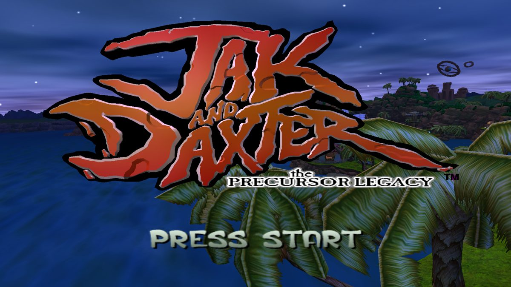
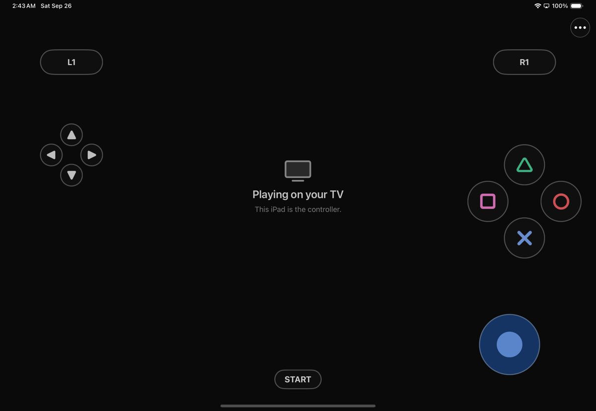
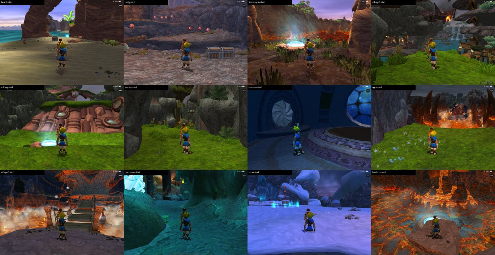

# Ottsel

  

  <strong>Jak and Daxter: The Precursor Legacy, native for iPad and iPhone.</strong> 
  The game's own code compiled ahead of time to signed ARM64, OpenGOAL's renderer on Metal, touch controls with a floating stick, controllers, TV output, cheats and texture packs.

Ottsel builds on [OpenGOAL](https://github.com/open-goal/jak-project), the open-source project that
decompiled Jak and Daxter back into GOAL source and wrote the compiler, runtime and renderer that run it
on PC. OpenGOAL provides the game; Ottsel maintains the iOS and iPadOS port: ahead-of-time compilation
for a platform without JIT, the Metal rendering path, touch and TV support, packaging and releases. The
projects are independently maintained.

  
  
  
  
  
  
  
  

> [!IMPORTANT]
> **Bring your own game data.** Ottsel needs your own Jak and Daxter: The Precursor Legacy disc image
> (NTSC-U `SCUS-97124`). This repository contains no disc image, extracted game files or saves.
>
> **Developer preview.** Every result below comes from the iPad and iPhone Simulators; Ottsel has not
> yet run on a physical iPad or iPhone, and there is no downloadable IPA. You build it on a Mac.
>
> **AI disclosure:** Ottsel uses substantial AI assistance for code, tests, documentation, debugging and
> maintenance. There is no audited percentage of AI-generated code. Status and test records describe
> what was checked. This disclosure concerns Ottsel's workflow, not the authorship of OpenGOAL.

## Get Ottsel

| Platform | Status | Setup |
| --- | --- | --- |
| iPad | Build from source; Simulator-tested | [Build from source](#build-from-source), then `scripts/install-ios-device.sh` |
| iPhone | Build from source; Simulator-tested | Same build (the app is universal) |
| Downloadable IPA | Not available yet | Waits until every game-derived file lives in your data pack |

**Need help or found a bug?** Join the [Discord](https://discord.gg/xwHfUD2bxW), or open a
[device report](https://github.com/chrissotraidis/ottsel/issues/new?template=device_report.yml) or
[bug report](https://github.com/chrissotraidis/ottsel/issues/new?template=bug_report.yml). A report from
a physical iPad or iPhone is the most useful thing you can send right now.

## Playing

[Frequently asked questions](#frequently-asked-questions) · [Mods, texture packs and cheats](docs/MODS.md) · [Current status](docs/STATUS.md)

- **Touch controls.** The move stick appears wherever your left thumb lands and follows it; L1/L2,
  R1/R2, the D-pad, the face buttons and the camera stick sit at the screen edges and respond to a
  sliding thumb. **••• → Controls** sets when they show, their opacity and size, and lets you move and
  resize each one.
- **Controllers and keyboards.** Apple game controllers work like a PlayStation pad; hardware keyboards
  use OpenGOAL's layout (W/A/S/D, I/J/K/L camera, Space/E/F/R, Return for Start). The touch controls hide
  while either is in use and return on your next touch.
- **Play on a TV.** Connect a TV or monitor over HDMI, USB-C or AirPlay: the game fills it at the
  display's resolution and the iPad becomes the controller. Unplug and the game returns to the iPad.
- **Cheats.** **••• → Cheats** switches OpenGOAL's cheats on in one tap: invincibility, infinite eco,
  big and huge heads, big fist, blue Daxter, mirror world and more. The original button codes work too.
- **Saves and interruptions.** Save from the pause menu as on the PS2; Load Game resumes after a
  relaunch. Leaving the app pauses the game and its sound, and you come back to the pause menu.
- **Texture packs.** `scripts/apply-texture-pack.sh` builds a data pack with any OpenGOAL-format texture
  pack. See the [mods guide](docs/MODS.md).

<table>
  <tr>
    <td width="50%"></td>
    <td width="50%"></td>
  </tr>
  <tr>
    <td align="center"><strong>The ••• menu</strong> Display, controls, cheats, game data and diagnostics.</td>
    <td align="center"><strong>Touch Control Settings</strong> Visibility, floating stick, opacity, size and camera.</td>
  </tr>
  <tr>
    <td width="50%"></td>
    <td width="50%"></td>
  </tr>
  <tr>
    <td align="center"><strong>On a TV</strong> The game at the display's resolution.</td>
    <td align="center"><strong>The iPad as controller</strong> Touch controls and menu stay on the iPad.</td>
  </tr>
</table>

## What has been tested

All of this is in the iPad Pro 11-inch (M4) and iPhone 16 Pro Simulators at native resolution.

| Area | Result |
| --- | --- |
| Game code | All 518 GOAL modules compiled ahead of time and signed into the app; loading code at run time is fatal |
| Levels | The intro plays through to Geyser Rock; all 16 hubs and levels load and run at 49–60 fps (2420×1668) with no faults |
| Saves | Saving in Sandover, quitting, relaunching and loading resumes in Sandover |
| Sound | Music, effects and dialogue mix and play; a recorded minute showed no clipping or dropouts |
| TV output | 1080p external display from a cold launch, unplugged and replugged mid-game |
| Touch | A scripted real-touch run plays title → Load Game → training course, walks, jumps and attacks |
| iPhone | Boots to the title with the full touch layout fitted to the screen |
| Physical devices | **Not yet tested.** The device build compiles, links and signs |

## Build from source

You need an Apple Silicon Mac with Xcode, `brew install cmake ninja ripgrep glslang spirv-cross xcodegen`,
an Apple ID signed in to Xcode for a physical device (a free Personal Team is enough), and your disc image.
The build downloads a prebuilt ANGLE; everything it generates stays under the ignored `out/` directory.

~~~sh
# 1. OpenGOAL at the pinned commit, plus Ottsel's patch
git clone https://github.com/chrissotraidis/ottsel && cd ottsel
git clone https://github.com/open-goal/jak-project out/jak-project
git -C out/jak-project checkout 641fb572e876750d8618434d9f7c1a531b43b366
git -C out/jak-project apply --binary ../../patches/ottsel-jak-project.patch

# 2. Host tools, your disc's data, and the game compiled for arm64
cd out/jak-project
cmake -S . -B build/h1 -G Ninja -DCMAKE_BUILD_TYPE=Release -DCMAKE_C_COMPILER=clang \
  -DCMAKE_CXX_COMPILER=clang++ -DSTATICALLY_LINK=OFF -DINSTALL_GTEST=OFF -DOTTSEL_NO_EMIT=ON
ninja -C build/h1 goalc extractor ottsel-a11-slice
./build/h1/decompiler/extractor --extract --decompile /path/to/jak1.iso
./build/h1/goalc/goalc --game jak1 --isa arm64 -c '(mi)'
cd ../..

# 3. The app (Simulator; add OTTSEL_PLATFORM=device for iPad or iPhone)
OTTSEL_STRICT_EXEC=1 OTTSEL_SIGNED_GSTATE_EXPERIMENT=0 OTTSEL_SIGNED_EXPORT_BANKS=1 \
  OTTSEL_SIGNED_MODULE_LIST=config/signed-game-strict.json bash scripts/build-ios.sh

# 4. A game-data pack from your disc, outside the repository
scripts/prepare-user-data-pack.sh out/jak-project/iso_data/jak1 /tmp/ottsel-pack out/jak-project/out/jak1/fr3
~~~

The first build takes about 12 minutes on an 8-core M-series Mac; later builds take a few minutes.

**Simulator:** `xcrun simctl install booted out/jak-project/out/ios/app/OttselShell.app`, then
`scripts/import-ios-user-data.sh <udid> /tmp/ottsel-pack` and `xcrun simctl launch booted com.ottsel.shell`.

**iPad or iPhone:** connect and trust the device, turn on Developer Mode, then run
`scripts/install-ios-device.sh /tmp/ottsel-pack`. It finds your signing identity, builds the device app,
installs it, copies your pack in and launches it. You can also import a pack later from Files with
**••• → Game Data → Import Game Data…**.

## Frequently asked questions

Does this repository include Jak and Daxter?

No. You need your own disc image. Please do not ask for game data or download links in issues or on
Discord.

Can I download an IPA?

Not yet. The app you build contains a few files generated from your disc (the compiled `KERNEL.CGO` and
`GAME.CGO`, the title and village DGO files, and the text files), so it is for your own devices only. A
shareable build waits until all of those move into the data pack.

Is Ottsel an emulator? Does it use a JIT?

Neither. OpenGOAL runs the game's own GOAL code natively; it does not emulate a PlayStation 2. On PC it
compiles that code while it runs, which iOS forbids, so Ottsel compiles all of it to ARM64 on your Mac and
signs it into the app. There is no JIT, no writable-and-executable memory and no code patching at run
time.

Does it run on a real iPad or iPhone?

It has not been tested on one yet. The device build compiles, links and signs, and
`scripts/install-ios-device.sh` installs it. If you try, please file a
[device report](https://github.com/chrissotraidis/ottsel/issues/new?template=device_report.yml) with the
frame rate from **••• → Show FPS Counter**.

Can I play on a TV?

Yes. Connect a TV or monitor over HDMI or USB-C, or use AirPlay. The game moves to it at the display's
resolution and the iPad keeps the controls; a paired controller works too. This has been tested with the
Simulator's external display; a real adapter has not been tried yet.

Can I use mods, texture packs, cheats or a higher frame rate?

Cheats are built in (**••• → Cheats**). Texture packs and replacement models go into your data pack on
the Mac; code mods and custom levels each need their own build. The [mods guide](docs/MODS.md) covers all
three. The game runs at 60 fps; OpenGOAL's experimental 100 and 150 fps modes can break Jak 1's
physics, so Ottsel does not offer them.

How do I test a later level without playing up to it?

**••• → Diagnostics → Jump to Level (Testing)** starts play at any hub or level, the way the game respawns
Jak, keeping your progress. It does not unlock anything, and some cutscenes and tasks expect the normal
order.

Why does the music stop in menus?

The game pauses music and effects whenever its pause or main menu is open, as it did on the PS2. It
resumes when you close the menu.

Is everything finished?

No. Still open: physical iPad and iPhone runs and their frame rate, heat and battery; a real HDMI adapter
and AirPlay; a full play-through past the opening (tasks, bosses and vehicle sections); and a shareable
build. The plan is in [`docs/GOAL_LOOP.md`](docs/GOAL_LOOP.md) and the running log in
[`docs/STATUS.md`](docs/STATUS.md).

## Build and contribute

Ottsel compiles OpenGOAL's GOAL code ahead of time for ARM64 and renders through OpenGOAL's own OpenGL
renderer on OpenGL ES 3.0, which [ANGLE](https://chromium.googlesource.com/angle/angle) translates to
Metal.

| Path | Purpose |
| --- | --- |
| [`src/shell/`](src/shell/) | The iOS app: boot, touch controls, the ••• menu, TV output and the icon |
| [`patches/ottsel-jak-project.patch`](patches/ottsel-jak-project.patch) | Every change to the pinned OpenGOAL commit ([refreshing it](patches/README.md)) |
| [`scripts/build-ios.sh`](scripts/build-ios.sh) | Builds the runtime, signs the game modules, translates shaders, assembles the app |
| [`scripts/install-ios-device.sh`](scripts/install-ios-device.sh) | Signs, installs and launches on a connected iPad or iPhone |
| [`scripts/prepare-user-data-pack.sh`](scripts/prepare-user-data-pack.sh) | Builds a game-data pack from your extracted disc |
| [`scripts/apply-texture-pack.sh`](scripts/apply-texture-pack.sh) | Builds a data pack with a texture pack applied |
| [`scripts/test-ios-touch.sh`](scripts/test-ios-touch.sh) | Plays title → Load Game → training course with real touches |
| [`docs/`](docs/) | The plan, the status log, the mods guide and the original research |

Changes to OpenGOAL go through `patches/ottsel-jak-project.patch`; refresh it with
`scripts/snapshot-jak-project.sh write`. For a bug report, include the exact commit, device, iOS version
and steps. Never attach game data, extracted files, a built app or saves.

## Credits and license

Ottsel stands on [OpenGOAL](https://github.com/open-goal/jak-project), whose team decompiled the game,
wrote the GOAL compiler and runtime, and built the renderer Ottsel uses. ANGLE comes from
[kivy/angle-builder](https://github.com/kivy/angle-builder); [SDL](https://github.com/libsdl-org/SDL)
provides the window and input; [glslang](https://github.com/KhronosGroup/glslang) and
[SPIRV-Cross](https://github.com/KhronosGroup/SPIRV-Cross) translate the shaders. The touch controls and
menu follow [SunPad](https://github.com/chrissotraidis/sunpad). See
[`THIRD_PARTY_NOTICES.md`](THIRD_PARTY_NOTICES.md) for every component and its license.

Ottsel is released under the [ISC License](LICENSE), the same license as OpenGOAL, so its changes can flow
back upstream; the patch's changes to OpenGOAL's files stay under OpenGOAL's license and copyright.
Ottsel is an unofficial community project and is not affiliated with or endorsed by Sony Interactive
Entertainment or Naughty Dog. Jak and Daxter names and screenshots are used only to identify the game.
The Ottsel icon is original artwork.
