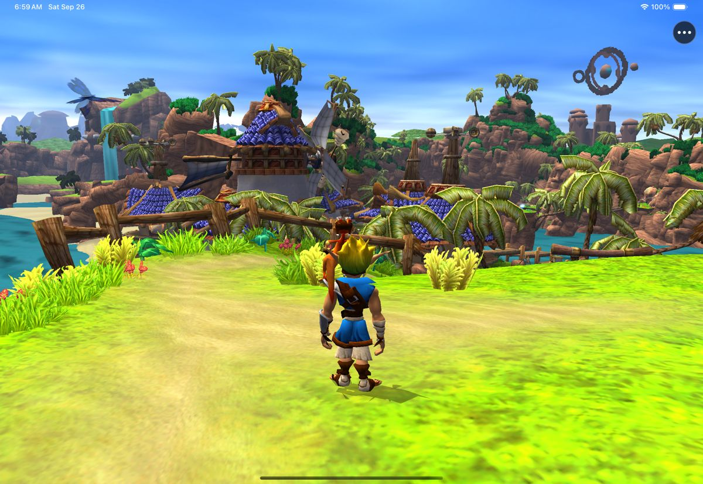

# Mods, texture packs and cheats

Ottsel runs OpenGOAL's game code compiled ahead of time and signed into the app, because iOS allows no
JIT. What you can change therefore splits in two: assets, which go into your build on the Mac, and code,
which needs its own build.

## Built in

- **Cheats.** **••• → Cheats** switches OpenGOAL's cheats on and off in one tap: invincibility, infinite
  eco of each colour, big, huge and small heads, big fist, big-headed villagers, blue Daxter, mirror world,
  real-time sky and every music flavour. The game's own **Secrets → Cheats** menu shows the same list.
- **Button codes.** The touch controls include L2 and R2, so the original codes (hold L1 + L2 + R1 + R2,
  then enter the sequence) work by touch as well as on a controller.
- **Jump to Level (Testing).** **••• → Diagnostics** starts play at any hub or level.

## Texture packs

OpenGOAL's extractor replaces a game texture with a PNG of the same name while it builds your level data.
A pack is a folder laid out as `<texture page>/<texture name>.png`, the layout OpenGOAL texture packs use,
for example [Jak 1 – Refreshed HUD](https://github.com/Aloqas/Jak-1-Refreshed-HUD) and the HD packs on
[JakMods.dev](https://jakmods.dev). Build a separate data pack with it:

```sh
ninja -C out/jak-project/build/h1 extractor          # once
scripts/apply-texture-pack.sh /path/to/texture_replacements /tmp/ottsel-pack-modded
scripts/import-ios-user-data.sh <simulator-udid> /tmp/ottsel-pack-modded   # or install-ios-device.sh
```

The script re-extracts your disc's level data with the pack (about 20 seconds), builds the data pack, and
then restores your original level data, so your normal pack is unaffected. To see which names exist, run the
extractor once with `--decomp-config-override '{"save_texture_pngs": true}'`; every texture lands in
`out/jak-project/decompiler_out/jak1/textures/<page>/`. Replacement textures load into memory with each
level, so try a large HD pack on one level before a long session on an iPad or iPhone.



Tested in the Simulator with a one-texture pack (Sandover's hut roof tiles recoloured); full community
packs have not been tried yet.

## Model replacements

The same extractor swaps a character or object model for a `.glb` file named after the model:

```text
out/jak-project/custom_assets/jak1/merc_replacements/<model name>.glb
```

## Gameplay mods and custom levels

Mods such as [OG Randomizer](https://github.com/OpenGOAL-Mods/OG-Randomizer), Speedrun Practice or
custom levels change the game's code. Each would need Ottsel's patch applied to that mod's OpenGOAL
source and a separate signed build; none is packaged yet. Check each mod's license before sharing a build.

Model replacements and code mods are untested in Ottsel; please report results with a
[device report](https://github.com/chrissotraidis/ottsel/issues/new?template=device_report.yml).
